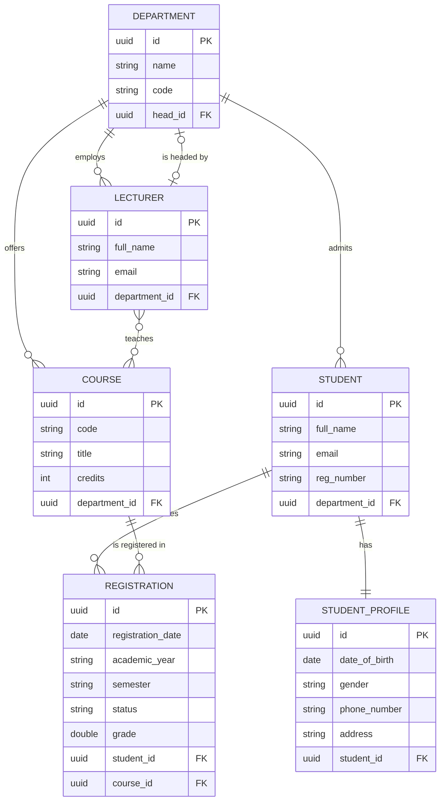
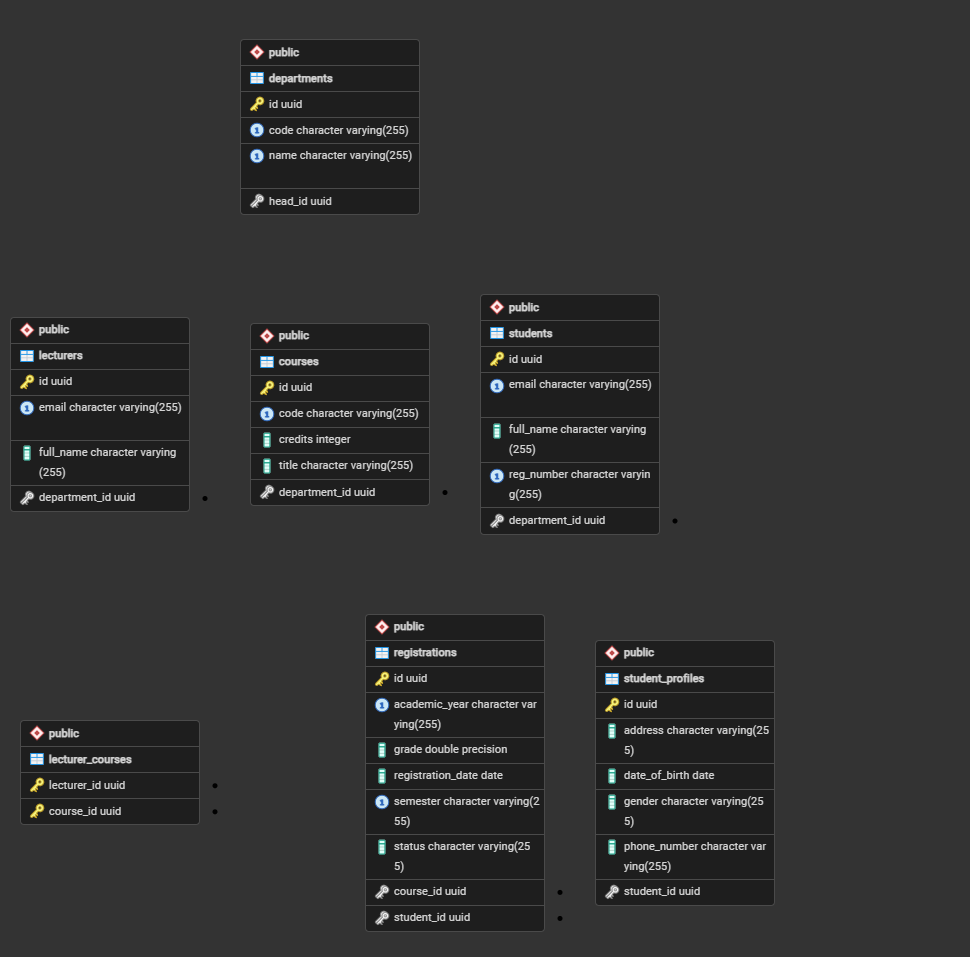
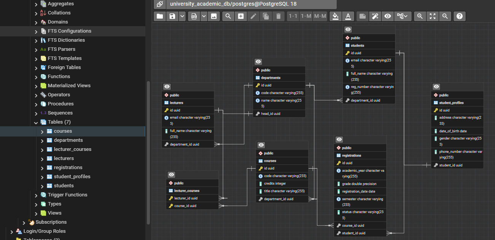

# University Course Registration and Academic Management System

**Student Name:** _Your Name_
**Registration No.:** _Your Reg No._

## Analysis and Design

### 1. Entities
- Department
- Lecturer
- Student
- StudentProfile
- Course
- Registration

### 2. Attributes
- **Department:** id, name, code
- **Lecturer:** id, fullName, email
- **Student:** id, fullName, email, regNumber
- **StudentProfile:** id, dateOfBirth, gender, phoneNumber, address
- **Course:** id, code, title, credits
- **Registration:** id, registrationDate, academicYear, semester, status, grade

### 3. Relationships
- Department offers Course
- Department employs Lecturer
- Department is headed by Lecturer
- Department admits Student
- Student has StudentProfile
- Lecturer teaches Course
- Student registers for Course (through Registration)

### 4. Cardinality
- Department – Course: One-to-Many
- Department – Lecturer (employs): One-to-Many
- Department – Lecturer (head): One-to-One
- Department – Student: One-to-Many
- Student – StudentProfile: One-to-One
- Lecturer – Course: Many-to-Many
- Student – Course: Many-to-Many (Student 1:N Registration, Course 1:N Registration)

### 5. Relationships requiring a foreign key
- Department – Course: `courses.department_id`
- Department – Lecturer (employs): `lecturers.department_id`
- Department – Lecturer (head): `departments.head_id`
- Department – Student: `students.department_id`
- Student – StudentProfile: `student_profiles.student_id`
- Student – Registration: `registrations.student_id`
- Course – Registration: `registrations.course_id`

### 6. Relationship requiring a join table
- Lecturer – Course (Many-to-Many), join table `lecturer_courses` (`lecturer_id`, `course_id`)

### 7. Relationship requiring a join entity
- Student – Course (Many-to-Many), join entity `Registration`

### 8. Entity Relationship Diagram


### 9. Pictures of the ERD 




### 10. Relational Database Schema

```
departments(id PK, name, code, head_id FK → lecturers.id)
lecturers(id PK, full_name, email, department_id FK → departments.id)
students(id PK, full_name, email, reg_number, department_id FK → departments.id)
student_profiles(id PK, date_of_birth, gender, phone_number, address, student_id FK → students.id)
courses(id PK, code, title, credits, department_id FK → departments.id)
lecturer_courses(lecturer_id FK → lecturers.id, course_id FK → courses.id, PK(lecturer_id, course_id))
registrations(id PK, registration_date, academic_year, semester, status, grade, student_id FK → students.id, course_id FK → courses.id)

```
